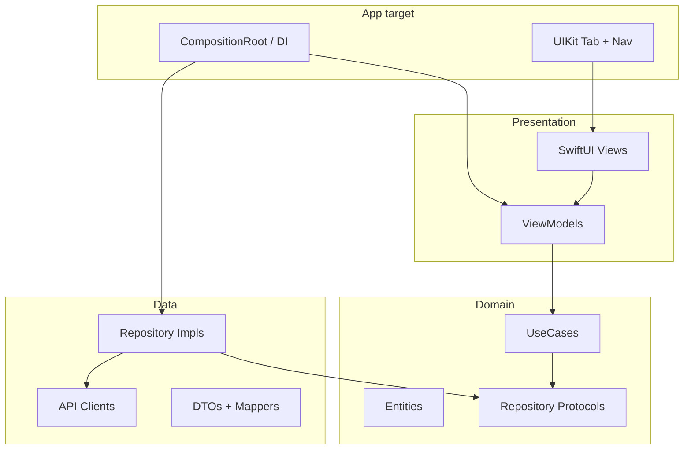

# AppStore 現代化プラン

学習用 App Store クローンを、モダンな基盤・設計・UI に置き換えるためのロードマップ。

## 前提（確定）

- **SDK**: iOS 27 + Xcode 27（beta 含む最新前提）
- **iPhone Duo**: シミュレータに `iPhone Duo` が存在する。Phase 4 では **大画面適応レイアウト**（`NavigationSplitView` / size class / マルチカラム）を基本とし、Duo 固有のサイズクラス・ペイン分割は実機/シミュレータで検証しながら詰める
- **RSS**: スコープに含める。[rss-api-replacement.md](./rss-api-replacement.md) に沿い、**旧 `itunes.apple.com/jp/rss/...` でチャート種を維持**し Codable でパーサ刷新。「We Love」は公式代替なしのため **新着 RSS 代用 or セクション削減**（実装時に1つに固定）
- **モジュール**: Phase 1 は **レイヤ分割（Clean Architecture）**。Phase 5 で **フィーチャーモジュール** を追加
- **UI**: Storyboard/xib 廃止 → **SwiftUI View を `UIHostingController` でホスト**（UIKit ナビは当面残す）
- **CLI ツール**: [Mint](https://github.com/yonaskolb/Mint) でバージョン固定管理（Homebrew で個別 CLI を入れない）

## 現状サマリ

- UIKit + xib/storyboard 中心、コントローラにデータ取得が密結合
- 非同期は Hydra、JSON は SwiftyJSON 混在、日付は SwiftDate、画像は Kingfisher
- 既存テストは Entity 周辺のみ
- XcodeGen + SwiftFormat を利用。CLI は Mintfile で固定（Phase 0）
- CI / Renovate / AI 向けインストラクションは Phase 0 で整備

## 目標アーキテクチャ

ローカル SPM 配置例:

- `Packages/Domain` — Entity / UseCase / Repository protocol（外部依存ゼロ）
- `Packages/Data` — URLSession + Codable、Repository 実装（Domain に依存）
- `Packages/Presentation` — ViewModel + SwiftUI（Domain に依存、Data には依存しない）
- App target — DI・Scene・Tab 組み立てのみ

依存規則: `App → Presentation → Domain ← Data`（Data は Domain のみ参照）

## 優先度マトリクス

| 優先 | 項目 | 理由 |
|------|------|------|
| P0 | AI instructions / Mint+Mintfile / XcodeGen+Xcode27 / CI骨格 / Renovate | 以降の速度と再現性 |
| P1 | ローカル SPM レイヤ分割 | 全リライトの土台 |
| P1 | ライブラリ削除 + async/Codable + RSS 差し替え + 単体テスト | 動く・測れるコア |
| P2 | MVVM + SwiftUI+VC 移行 | 量大だが境界ができてからが安全 |
| P3 | Liquid Glass / 大画面適応 | UI 基盤後が効率的 |
| P3 | フィーチャーモジュール | レイヤ安定後に垂直分割 |
| P4 | CI 厳格化・ドキュメント仕上げ | 締め |

---

## Phase 0 — 開発基盤

**ステータス**: done

完了内容:

1. AI インストラクション整備（`AGENTS.md`）
2. Mint 導入（`Mintfile` / Makefile / README）— XcodeGen 2.46.0 / SwiftFormat 0.64.1
3. XcodeGen 最新化 + Xcode 27 / iOS 27 対応（`project.yml`）
   - `IPHONEOS_DEPLOYMENT_TARGET: 27.0`
   - Swift 言語モードは当面 `5.0`（Swift 6 concurrency は既存 UIKit が大量エラーになるため、モジュール化・MVVM と一緒に Phase 1–2 で上げる）
   - 古い `preBuildScripts` / `script/swiftpm.sh` を削除
   - scheme に unit test を接続
4. CI 骨格（`.github/workflows/ci.yml` / `runs-on: xcode-27`）
5. Renovate 導入（`renovate.json` — SPM / Actions / Mintfile）

## Phase 1 — レイヤ型マルチモジュール骨格

**ステータス**: pending

1. ローカル SPM で `Domain` / `Data` / `Presentation` を追加し XcodeGen から参照
2. 既存 Entity を Domain へ、ネットワーク実装は Data へ
3. 各パッケージに Unit Test target（Domain/Data 必須、Presentation は ViewModel 中心）
4. App target は薄い Composition Root に寄せる

## Phase 2 — コア現代化 + RSS 差し替え

**ステータス**: pending

1. Hydra → `async/await`、SwiftyJSON → `Codable`、SwiftDate → Foundation。Kingfisher は当面残す
2. ランキングを旧 iTunes RSS + 新 DTO/Mapper に差し替え。Search / Lookup / Reviews は Repository 経由に統一
3. Repository / UseCase + ユニットテスト必須（fixture JSON、ViewModel はモック注入）

## Phase 3 — MVVM + SwiftUI 移行

**ステータス**: pending

推奨順: Search → Ranking → Details/Reviews → Tab/ルート → xib/storyboard 削除

各画面: `UIViewController` + `UIHostingController` + ViewModel。ロジックは VC に置かない。

## Phase 4 — Liquid Glass + 大画面適応（Duo 仮置き）

**ステータス**: pending

1. Liquid Glass 系 API をタブ・ナビ・カードに適用
2. regular width でリスト+詳細スプリット
3. compact はプッシュ遷移を維持

## Phase 5 — フィーチャーモジュール化

**ステータス**: pending

例: `FeatureApps` / `FeatureGames` / `FeatureSearch` / `FeatureAppDetail`  
レイヤ安定後に垂直分割。循環依存が出たら `UIComponents` へ抽出。

## Phase 6 — 品質締め

**ステータス**: pending

1. CI で Domain/Data テスト必須
2. ロジック変更時のテスト有無をインストラクションと CI で担保
3. README / アーキテクチャ図の最終更新
4. 残存デッドコード・Kingfisher の最終判断

---

## 意図的に後回しにするもの

- ピクセルパーフェクトな公式 App Store 再現
- iPhone Duo 固有 API（仕様確定まで adaptive layout で代替）
- UI テスト拡充（まず Domain/Data/VM の単体テストを定着）
- Kingfisher 即削除

## リスク

- Xcode 27 / iOS 27 の API 変更で Glass・大画面周りが揺れうる → Phase 4 に隔離
- 旧 iTunes RSS も将来死ぬ可能性 → Repository 境界で差し替え可能にする
- 一気に Feature 分割すると移動コスト大 → **必ずレイヤ → Feature の順**
