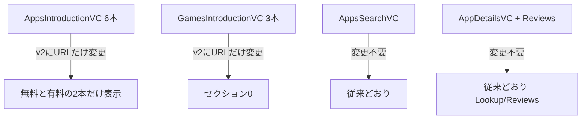

# RSS / iTunes API 差し替え調査

調査日: 2026-10-24  
対象: `AppStore/Utilities/URLMaker.swift` の URL を新 API に変えた場合、既存実装のまま従来どおり動くか

## 結論

**新しい RSS URL に変えるだけでは、今まで通りのアプリにはならない。**

- 検索・詳細・レビューは URL 変更不要で、現状のパーサのまま使える。
- ランキング一覧は、新 API（`rss.marketingtools.apple.com` v2）がカバーするチャートが **無料 / 有料の2種だけ** で、既存の9チャートのうち7本に相当 URL がない。
- その2種については JSON 形が近く、`AppsGroup` のデコードは通る。ただしセクション見出しの日本語変換は壊れる。
- 旧チャート相当を全部残すなら、さらに古い `itunes.apple.com/jp/rss/...` は生きているが、JSON 形が全く違うのでパーサ改修が必要。URL 差し替えだけでは不可。

## アプリが今使っている URL

| 画面 | 識別子 | 現行 URL |
|---|---|---|
| Apps タブ | `recommendedNewApps` | `rss.itunes.apple.com/.../new-apps-we-love/all/15/explicit.json` |
| Apps タブ | `topFree` | `.../top-free/all/15/explicit.json` |
| Apps タブ | `ipadTopFree` | `.../top-free-ipad/all/15/explicit.json` |
| Apps タブ | `topSales` | `.../top-grossing/all/15/explicit.json` |
| Apps タブ | `ipadTopSales` | `.../top-grossing-ipad/all/15/explicit.json` |
| Apps タブ | `topPaid` | `.../top-paid/all/15/explicit.json` |
| Games タブ | `recommendedNewGames` | `.../new-games-we-love/all/15/explicit.json` |
| Games タブ | `topFreeGames` | `.../top-free/games/15/explicit.json` |
| Games タブ | `topPaidGames` | `.../top-paid/games/15/explicit.json` |
| 検索 | `search` | `https://itunes.apple.com/search?...` |
| 詳細 | `detail` | `https://itunes.apple.com/lookup?id=...` |
| レビュー | `review` | `http://itunes.apple.com/jp/rss/customerreviews/id=.../json` |

ランキングはすべて `https://rss.itunes.apple.com/api/v1/jp/ios-apps/` 配下。このホストは 2026-10-24 時点で **HTTP 503（Akamai DNS failure）** で、ルート URL も含めて死んでいる。

## 新 RSS（v2）でできること / できないこと

公式 RSS Builder の実体は次の形。

```text
https://rss.marketingtools.apple.com/api/v2/{country}/apps/{chart}/{limit}/apps.json
```

公開されている chart は実質 `top-free` と `top-paid` のみ（limit は 10 / 25 / 50。15 も実測では通る）。

| 現行機能 | v2 相当 URL | 実測 |
|---|---|---|
| トップ無料 App | `/api/v2/jp/apps/top-free/15/apps.json` | 200、15件 |
| トップ有料 App | `/api/v2/jp/apps/top-paid/15/apps.json` | 200、15件 |
| トップセールス | `/api/v2/jp/apps/top-grossing/15/apps.json` | **404** |
| iPad 無料 / セールス | `ipad-apps` / `top-free-ipad` など | **404** |
| ゲーム無料 / 有料 | `.../top-free/games/15/apps.json` など | **404** |
| おすすめの新着 App / ゲーム | `new-apps-we-love` / `new-games-we-love` | **404 またはタイムアウト** |

`rss.applemarketingtools.com` は v2 ホストへ 301 するだけ。別 API ではない。

つまり URL を v2 に付け替えた場合:

- Apps タブ: 6セクション中 **2つだけ** 表示（無料・有料）。新着おすすめ、iPad、セールスは空。
- Games タブ: 3セクション中 **0**。画面としてほぼ空になる。

## `AppsGroup` はそのまま読めるか

既存デコーダが読むのはこれだけ。

- `feed.title`
- `feed.results[]` の `id`, `name`, `artistName`, `artworkUrl100`

v2 の1件目（実測）:

```json
{
  "id": "6760173601",
  "name": "Muse from Meta",
  "artistName": "Meta Platforms, Inc.",
  "artworkUrl100": "https://is1-ssl.mzstatic.com/image/thumb/.../100x100bb.png",
  "kind": "apps",
  "url": "https://apps.apple.com/jp/app/muse-from-meta/id6760173601",
  "releaseDate": "2026-10-22",
  "genres": []
}
```

`id` は文字列の数値 ID のまま。カルーセル選択 → `GetAppDetails(id:)` の Lookup にはそのまま渡せる。

v2 `top-free` 15件を既存必須キーで検証した結果、**15/15 デコード可能**。  
一覧セル（名前・開発者・アイコン）は、**無料/有料の2チャートに限ればコード変更なしで描画できる**。

v1 にあって v2 で落ちている項目（`artistId`, `artistUrl`, `contentAdvisoryRating` など）は `App` が使っていないので、一覧表示には影響しない。

## 見出し（TitleConversion）は壊れる

`AppsGroupCell.titleConversion()` は、API の `feed.title` が次の英語固定文字列であること前提。

- `Top Free iPhone Apps`
- `Top Paid iPhone Apps`
- `Top Grossing iPhone Apps`
- `Top Free iPad Apps`
- `Top Grossing iPad Apps`
- `おすすめの新着App` / `おすすめの新着ゲーム`

v2 の title は日本語で、かつ粒度が粗い。

- `無料アプリ`（旧: `Top Free iPhone Apps` ではない）
- `有料アプリ`（旧: `Top Paid iPhone Apps` ではない）

マッチしないので変換は `nil`。画面には API の「無料アプリ」「有料アプリ」がそのまま出る。  
Games タブ用の「トップ無料ゲーム」なども、そもそもゲーム用フィードが無いので出ない。

「今までと同じ日本語見出し」にするには、`TitleConversion` の照合文字列を直すか、タイトルをクライアント側で固定する必要がある。URL 差し替えだけでは足りない。

## 検索・詳細・レビュー（変更不要）

| API | 実測 | 既存パーサ |
|---|---|---|
| Search `term=LINE` | 200、`resultCount=46` | `AppDetails` 必須キーで **46/46 パース可** |
| Lookup `id=443904275`（LINE） | 200、`resultCount=1` | 必須キー欠損なし |
| Reviews RSS | HTTP→HTTPS 後 200、entry 50 | `author.name.label` / `im:rating` / `title` / `content` で **50/50 パース可** |

レビュー URL の `http://` はリダイレクトで動く。HTTPS に揃えるのは任意。

詳細画面はランキングの `id` を Lookup に渡すだけなので、v2 の無料/有料一覧から遷移する範囲では従来どおり動く。

## 「今まで通り」に近づける別ルート

v2 で欠けるチャートは、さらに古い iTunes RSS がまだ返す。

```text
https://itunes.apple.com/jp/rss/topfreeapplications/limit=15/json
https://itunes.apple.com/jp/rss/toppaidapplications/limit=15/json
https://itunes.apple.com/jp/rss/topgrossingapplications/limit=15/json
https://itunes.apple.com/jp/rss/topfreeipadapplications/limit=15/json
https://itunes.apple.com/jp/rss/topgrossingipadapplications/limit=15/json
https://itunes.apple.com/jp/rss/topfreeapplications/limit=15/genre=6014/json   # Games
https://itunes.apple.com/jp/rss/toppaidapplications/limit=15/genre=6014/json
https://itunes.apple.com/jp/rss/newapplications/limit=15/json
```

2026-10-24 時点でいずれも 200。ジャンル付き・iPad・セールスも取れる。

ただし JSON は Atom 風で、`AppsGroup` とは非互換。

| 既存 (`results[]`) | 旧 RSS (`entry[]`) |
|---|---|
| `id` 文字列 | `id.attributes["im:id"]` |
| `name` | `im:name.label` |
| `artistName` | `im:artist.label` |
| `artworkUrl100` | `im:image[].label`（サイズ別配列） |
| `feed.title` 例: `Top Free iPhone Apps` | 例: `iTunes Store: トップ無料アプリ` |

この系統に切り替えるなら **URL 変更 + `AppsGroup` / `App` のデコード改修 + TitleConversion 改修** がセット。  
「おすすめの新着（We Love）」の公式代替は見つからなかった。`newapplications` は「新規公開アプリ一覧」であり、編集おすすめではない。件数も limit=15 指定でも 105 件返ることがある。

## 画面単位の影響



| 画面 | URL だけ v2 に変えた場合 |
|---|---|
| Apps タブ | 部分動作。2/6 セクション。見出しは未変換の「無料アプリ」「有料アプリ」 |
| Games タブ | 実質動かない |
| 検索 | 現状のまま動く |
| 詳細・レビュー | 現状のまま動く。一覧から渡る id も Lookup 可能な形式 |

## 今まで通りにするのに必要な作業

1. **URL 差し替えだけでは足りない** ことを前提にする。
2. 最低限動かす（無料/有料の全体ランキングだけ残す）なら:
   - `rssBase` を v2 に変更
   - 存在しないチャート用プロパティを削除、または取得失敗を許容
   - `TitleConversion` を v2 の `無料アプリ` / `有料アプリ` に合わせる
3. 従来の9セクション構成を維持するなら:
   - ランキング取得を旧 `itunes.apple.com/jp/rss/...` に切り替え
   - `AppsGroup` を `feed.entry` 形式に合わせて書き直す
   - 「We Love」は同等 API が無いので、新着 RSS で代用するかセクション廃止する
4. 検索 / Lookup / レビューは触らなくてよい。レビューは HTTPS 化だけ任意。

## 実測メモ

- v2 `top-free`: title=`無料アプリ`, 15件, 先頭 `Muse from Meta` (`6760173601`)
- v2 `top-paid`: title=`有料アプリ`, 15件, 先頭 `280blocker` (`1071235820`)
- v2 `top-grossing` / ゲーム / iPad / We Love: 404
- Search / Lookup / Reviews: 上記のとおりパーサ互換
- 旧 iTunes RSS: チャート種は揃うがスキーマ非互換
